<div align="center">


# Buýt Sài Gòn

**Ứng dụng xe buýt TP.HCM: tra tuyến, trạm gần bạn, tìm đường, và báo thức trước trạm cần xuống.**<br/>
Miễn phí · Không quảng cáo · Chạy offline · Mã nguồn mở · Dữ liệu mở OpenStreetMap

[](https://flutter.dev)
[](https://github.com/gooduselabs/hcm-bus/releases)
[](#-build)
[](https://m3.material.io)
[](LICENSE)
[](https://www.openstreetmap.org/copyright)
[](https://github.com/gooduselabs/hcm-bus/releases)


<a href="https://github.com/gooduselabs/hcm-bus/releases"></a>

</div>

> [!WARNING]
> **Bản thử nghiệm sớm (v0.2.0, pre-release), chưa kiểm thử trên điện thoại thật.** Logic tìm đường, báo thức và đọc dữ liệu đã có unit test; ảnh màn hình được chụp bằng golden test (nền bản đồ là bản đồ tĩnh offline). APK ký bằng khóa debug.

> [!IMPORTANT]
> **Chưa có giờ xe GPS thời gian thực.** Hiện không có API vị trí xe buýt TP.HCM nào *công khai, có tài liệu và cho phép ứng dụng bên thứ ba dùng lại*. App **không** dùng API riêng của MultiGo, BusMap hay `apicms.ebms.vn`. Giờ "xe sắp đến" là **ước tính theo lịch** (thẻ `interval` + `opening_hours` trên OSM) và luôn được ghi rõ như vậy. Mã nguồn đã có sẵn giao diện `RealtimeProvider` để cắm dữ liệu thật khi có hợp tác chính thức với Trung tâm Quản lý Giao thông công cộng TP.HCM.

---

## 📸 Ảnh màn hình

| Khám phá (bản đồ) | Chi tiết tuyến | Trạm & xe sắp đến |
|:---:|:---:|:---:|
| 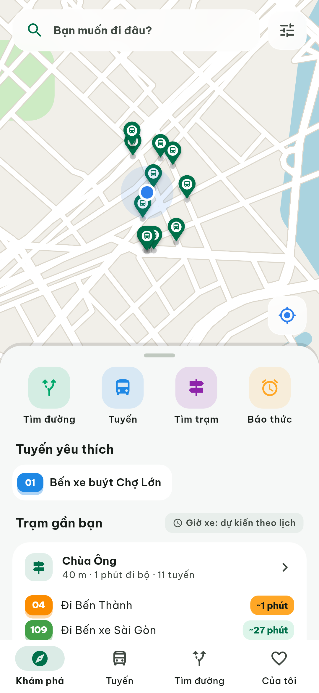 | 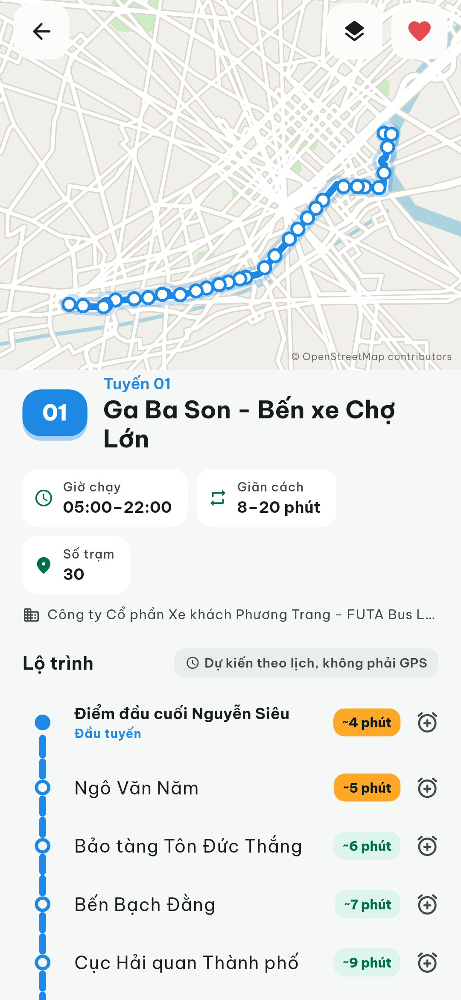 | 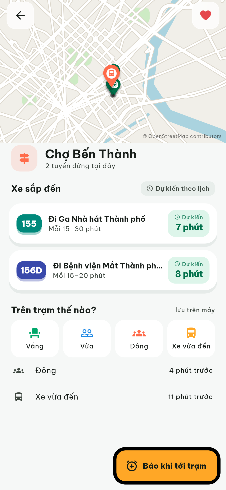 |
| **Tìm đường** | **Báo thức xuống trạm** | **Danh sách tuyến** |
| 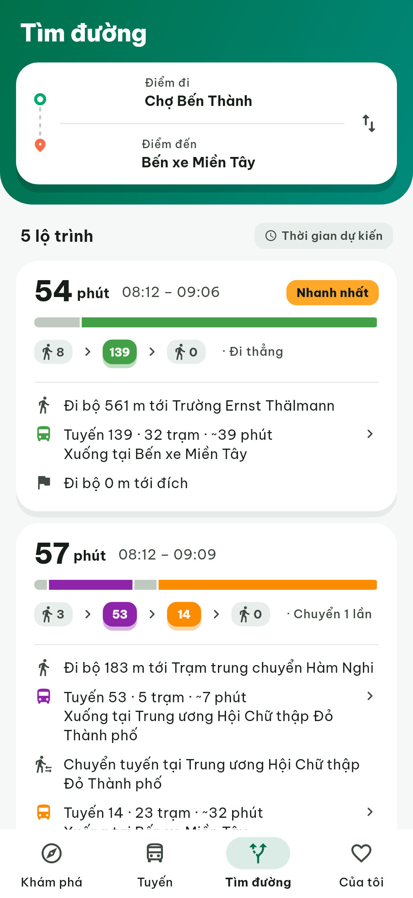 | 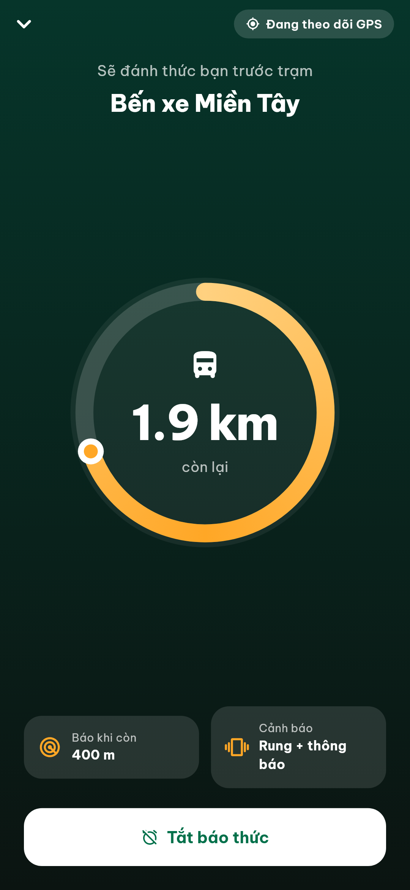 | 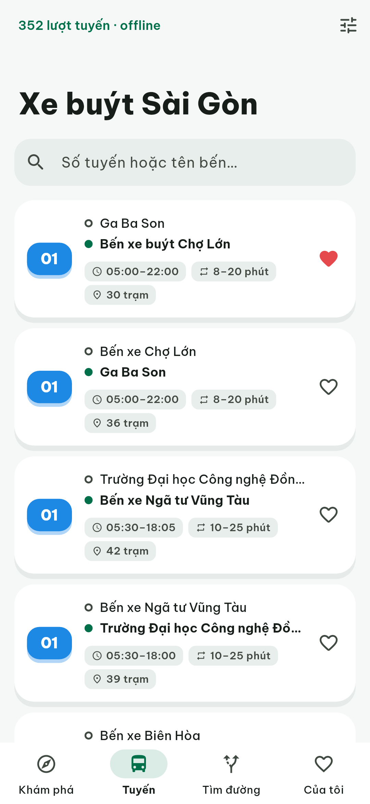 |
| **Khám phá (tối)** | **Chi tiết tuyến (tối)** | **Tìm đường (tối)** |
| 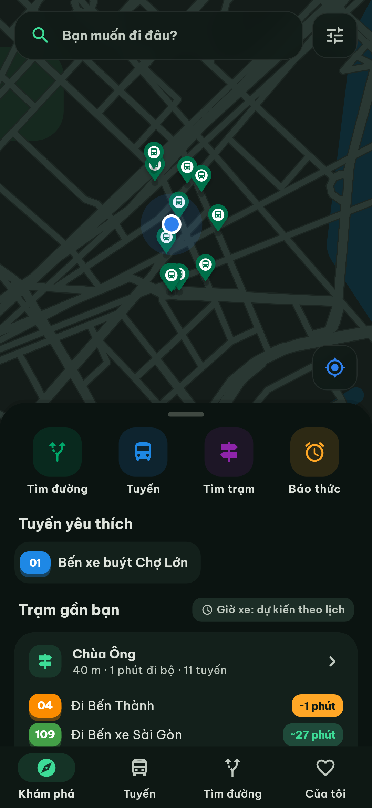 | 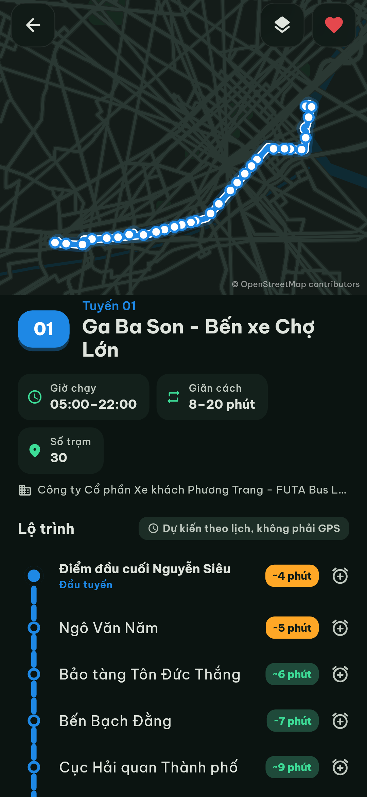 | 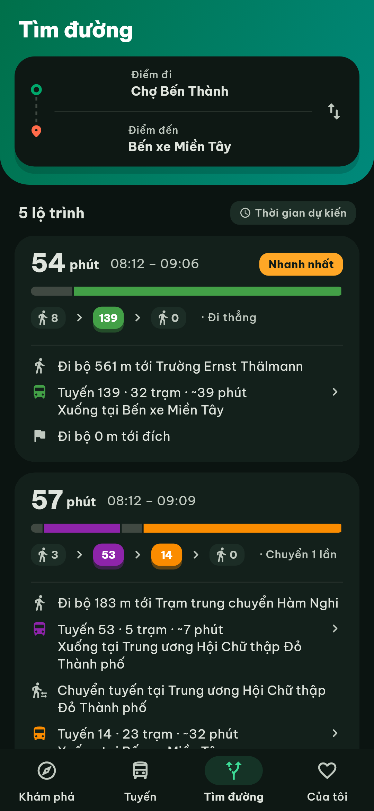 |
| **Giới thiệu** | **Của tôi** | **Cài đặt** |
| 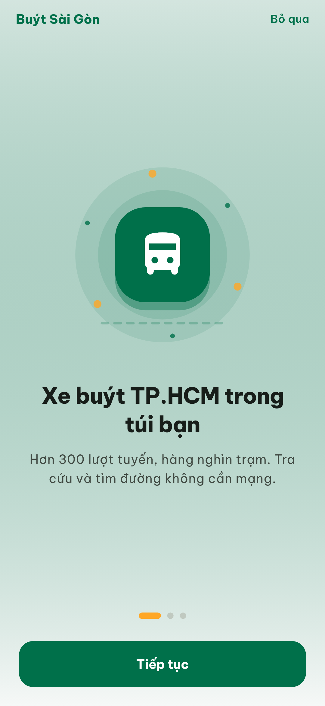 | 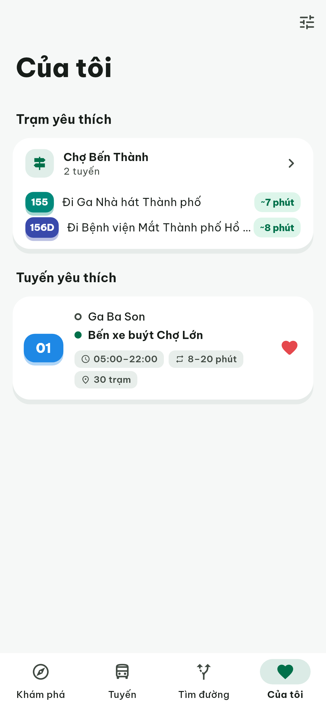 | 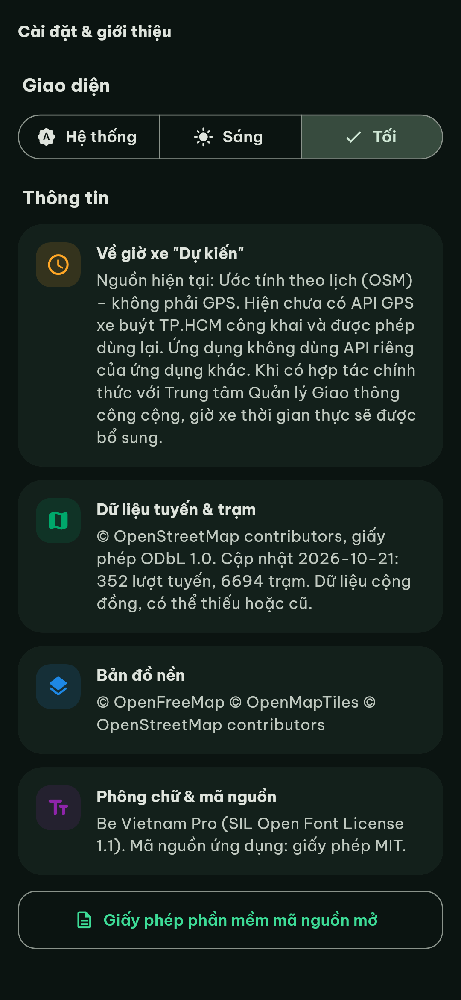 |

<sub>Ảnh chụp bằng golden test; nền bản đồ trong ảnh là bản đồ tĩnh vẽ từ dữ liệu OSM đóng gói (chế độ offline của app). Khi có mạng, app dùng bản đồ MapLibre + OpenFreeMap.</sub>

## ✨ Tính năng

**🎨 Thiết kế (v0.2)**
- Trang chủ dạng bản đồ với bottom sheet kéo được: tìm kiếm, trạm gần bạn kèm viên giờ xe *Dự kiến*, tuyến yêu thích
- Bảng màu xanh buýt Sài Gòn + cam ấm, phông **Be Vietnam Pro**, số tuyến có màu riêng
- Lộ trình dạng timeline, thẻ hành trình có thanh thời lượng theo chặng, màn báo thức có vòng tiến độ lớn
- Thanh kính mờ trên bản đồ, Hero transition, rung phản hồi, hiệu ứng nhấn, chế độ tối tinh chỉnh riêng

**🚌 Tra cứu**
- 🔎 Tìm tuyến theo số hoặc tên bến, tìm trạm **có dấu hay không dấu** đều được
- 🗺️ Chi tiết tuyến trên bản đồ MapLibre (OpenFreeMap), hoặc *Sơ đồ offline* khi mất mạng
- 📍 Trạm gần bạn qua GPS (mặc định quanh chợ Bến Thành nếu chưa cấp quyền)
- ⏱️ Giờ chạy, giãn cách chuyến, ước tính xe sắp đến (ghi rõ là ước tính)

**🧭 Tìm đường**
- Đi thẳng hoặc **chuyển 1 tuyến**, có tính quãng đi bộ (≤ 700 m) và đi bộ khi chuyển tuyến (≤ 250 m)
- Xếp hạng theo tổng thời gian ước tính (đi bộ + chờ + đi xe)

**⏰ Đánh thức trước trạm**
- Chọn trạm cần xuống, chọn bán kính 300/500/800 m
- Theo dõi GPS cả khi khóa màn hình (Android: foreground service; iOS: background location)
- Rung mạnh + thông báo; lọc nhiễu GPS (bỏ điểm sai số lớn, cần 2 lần liên tiếp) và báo sớm theo tốc độ

**👥 Cộng đồng & cá nhân**
- Báo cáo nhanh: *Vắng / Vừa / Đông / Xe vừa đến* (hiện lưu trên máy, đồng bộ backend ở bản sau)
- Yêu thích tuyến và trạm
- Material 3, giao diện sáng/tối, onboarding, splash, adaptive icon, hiệu ứng mượt
- 📴 Toàn bộ dữ liệu tuyến/trạm đóng gói sẵn: **tra cứu và tìm đường không cần mạng**

## 🗂️ Dữ liệu & giấy phép

| Thành phần | Nguồn | Giấy phép |
|---|---|---|
| Tuyến, trạm, giờ chạy | [OpenStreetMap](https://www.openstreetmap.org) qua Overpass API (`tools/build_data.py`) | **ODbL 1.0**: © OpenStreetMap contributors |
| Bản đồ nền | [OpenFreeMap](https://openfreemap.org) (style `liberty` / `dark`), dữ liệu OpenMapTiles | Miễn phí, cho phép dùng trong app ([ToS](https://openfreemap.org/tos/)); ghi công © OpenFreeMap © OpenMapTiles © OSM |
| Phông chữ | [Be Vietnam Pro](https://github.com/bettergui/BeVietnamPro) | SIL **OFL 1.1** (`assets/fonts/OFL.txt`) |
| Mã nguồn | Repo này | **MIT** ([LICENSE](LICENSE)) |

Dữ liệu hiện có (ngày 21/10/2026): **352 lượt tuyến** (mỗi chiều tính là một lượt) và **6.694 trạm**, trong vùng TP.HCM mở rộng (gồm Bình Dương, Bà Rịa–Vũng Tàu cũ, và một số tuyến lân cận Đồng Nai/Long An). Dữ liệu này do cộng đồng OSM đóng góp nên **có thể thiếu tuyến, sai thứ tự trạm hoặc lỗi thời**. Hãy sửa trực tiếp trên OpenStreetMap, mọi người cùng được hưởng.

Cập nhật dữ liệu:
```bash
python3 tools/build_data.py        # tạo lại assets/data/hcm_bus.json
```

## 🛠️ Build

```bash
flutter pub get
flutter analyze && flutter test
flutter build apk --release          # Android (hiện ký bằng khóa debug)
flutter test test/screenshots_test.dart --update-goldens   # chụp lại ảnh màn hình
```
**iOS:** mã nguồn và `Info.plist` (quyền vị trí nền, `UIBackgroundModes: location`) đã có, nhưng **cần macOS + Xcode** để build và ký: `cd ios && pod install && flutter build ios`.

## 🏗️ Kiến trúc

```
lib/
├─ core/       geo (Haversine, bỏ dấu tiếng Việt)
├─ data/       models + chỉ mục lưới trạm (BusData)
├─ domain/     planner (thẳng + 1 chuyển), geofence (WakeAlarm), schedule (ước tính)
├─ realtime/   RealtimeProvider: ScheduleEstimate (mặc định), Mock; chỗ cắm API chính thức
├─ services/   vị trí nền, thông báo, rung
├─ state/      Riverpod providers
└─ ui/         go_router, màn hình Material 3, BusMap (MapLibre / sơ đồ)
tools/build_data.py   Overpass → JSON offline
```

## 🗺️ Lộ trình

- [x] v0.2: thiết kế lại giao diện (bản đồ làm trang chủ, timeline, thẻ hành trình, màn báo thức)
- [x] v0.1: tra cứu offline, tìm đường 1 chuyển, đánh thức trước trạm, báo cáo cục bộ
- [ ] Widget màn hình chính, đọc thông báo bằng giọng nói tiếng Việt
- [ ] Tải bản đồ offline (trong giới hạn của OpenFreeMap: 3.000 ô/50 MB)
- [ ] Backend nhỏ: đồng bộ báo cáo cộng đồng, ETA từ báo cáo
- [ ] Giờ xe GPS thời gian thực, **chỉ khi có hợp tác chính thức** với Trung tâm QLGTCC TP.HCM
- [ ] Tìm đường có metro số 1, buýt sông; nhiều lần chuyển
- [ ] Ký release và phát hành trên Google Play / App Store

## 📄 Giấy phép

Mã nguồn: [MIT](LICENSE). Dữ liệu tuyến/trạm: © OpenStreetMap contributors, [ODbL](https://opendatacommons.org/licenses/odbl/). Ứng dụng này không liên kết với cơ quan nhà nước, BusMap hay MultiGo.
